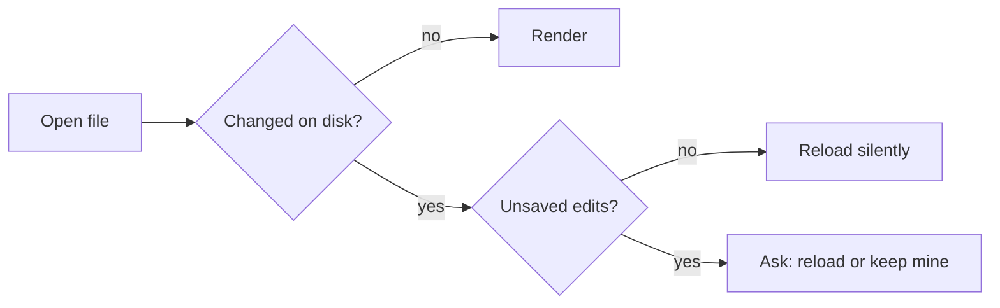
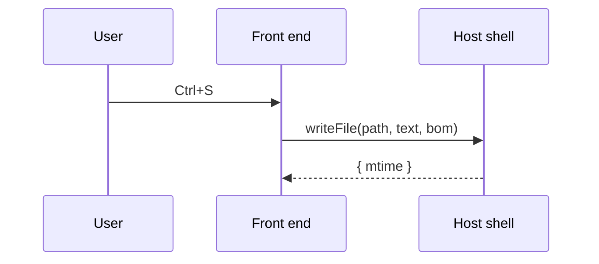

# MdTiger spike showcase

This document exercises the spike checks. Headings below are written the way
AI tools often write them, some already numbered: the outline must show them
exactly as written.

## 1. Code blocks (S2)

Select from **this paragraph** into the code block below, then copy and paste
into Word or Outlook: the code part must arrive without colors.

```powershell
# Find large log files
Get-ChildItem -Path C:\Logs -Recurse -Filter *.log |
    Where-Object Length -gt 10MB |
    Sort-Object Length -Descending |
    Select-Object FullName, @{ n = 'MB'; e = { [math]::Round($_.Length / 1MB, 1) } }
```

```csharp
public sealed record Heading(int Level, string Text, int From)
{
    public static Heading Parse(string line, int from) =>
        new(line.TakeWhile(c => c == '#').Count(), line.TrimStart('#', ' '), from);
}
```

```json
{ "name": "MdTiger", "startupTargetMs": { "warm": 1000, "cold": 2000 }, "tabs": true }
```

```
A block with no language tag.
    Indentation must survive copying.
```

Inline code like `Get-Process | Sort-Object CPU` stays inline.

## 2. Task lists (S5)

- [ ] Plain open task
- [x] Done task (lowercase x)
- [X] Done task (uppercase X: unticking and ticking again keeps the X)
- [ ] Parent task
  - [ ] Nested child task
  - [x] Nested done child
1. [ ] Numbered task
2. [x] Numbered done task

## 3. Mermaid (S4)





This one has a deliberate syntax error; the rest of the document must keep
rendering:

```mermaid
flowchart LR
    A --> 
    this is not valid mermaid ((
```

## 4. Tables

| Requirement | Priority | Status |
|---|:---:|---:|
| Code-block copy | M | done |
| Outline tree | M | done |
| Live preview | Phase 2 | groundwork |

Typical AI table with uneven padding and missing outer pipes:

Shell | Startup | Notes
--- | --- | ---
Tauri 2 | ? | thin Rust layer
WPF + WebView2 | ? | C# shell

### 4.1 Escaped pipes

| Expression | Meaning |
|---|---|
| `a \| b` | a or b |
| x \| y | escaped in text |

## 5. Links and images

- Anchor: [jump to the code blocks](#1-code-blocks-s2)
- Relative Markdown file: [tables.md](tables.md) (opens in a new tab)
- External: [Tauri website](https://tauri.app)
- Autolink: <https://github.com>
- Bare URL: https://www.example.com

Local image:


Remote image (needs network; shows a placeholder when offline, retries on resume):


## 6. Other blocks

> A blockquote with **bold**, *italic*, ~~strikethrough~~ and `code`.
> Second line of the quote.

Line with a hard break  
right here.

<details>
<summary>Raw HTML details block</summary>

Content inside a details element.

</details>

---

### 6.1 Deeper heading

#### 6.1.1 Even deeper

##### Level five

###### Level six

## 7. Setext heading below

Setext level 2
--------------

Final paragraph.
